<p align="center">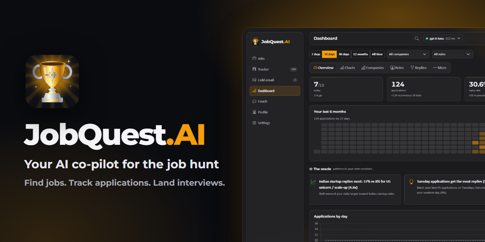</p>

<p align="center">
  <a href="../../releases/latest"></a>
  
  
  
  
</p>

<h1 align="center">JobQuest.AI</h1>

<p align="center"><b>Turn the job hunt into a quest you win.</b><br>
Finds entry-level jobs in India, ranks them against your resume with the AI models you choose, tracks every application, and handles the outreach around them.</p>

<p align="center"><a href="../../releases/latest"><b>Download for Windows</b></a> · <a href="#features">Features</a> · <a href="#run-it">Run it</a> · <a href="#how-the-desktop-app-is-built">How it's built</a></p>

<p align="center">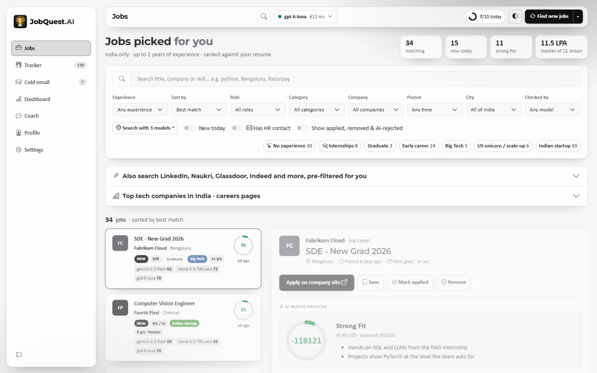</p>

| | |
|---|---|
| **145+ job boards** | One search across company boards and job APIs, filtered by experience, category, role and 30 tech cities |
| **10 AI providers, or add your own** | OpenAI, Claude, Gemini, Groq and more, a local model, or any new OpenAI-compatible service. Compare several on the same jobs |
| **Real analytics** | Averages, medians, top 10 charts, company tables, and an oracle that draws charts on request |
| **Careful outreach** | Review every draft, then send a batch with one click, at a safe pace |
| **Yours and encrypted** | Runs on your PC, keys encrypted, optional sync between PCs through your own MongoDB Atlas |

> Built as a capstone project: a full-stack Python application covering data ingestion from 140+ job boards, an
> LLM layer with structured outputs and provider fallback, analytics, email integration, encrypted sync and desktop packaging.

## Screenshots

| Dashboard with top 10 charts | Ask the oracle for any chart |
|---|---|
| 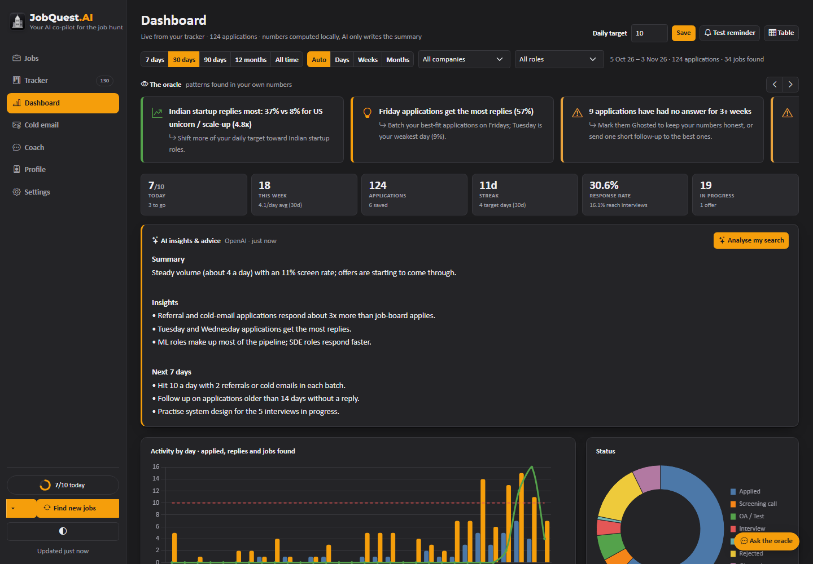 | 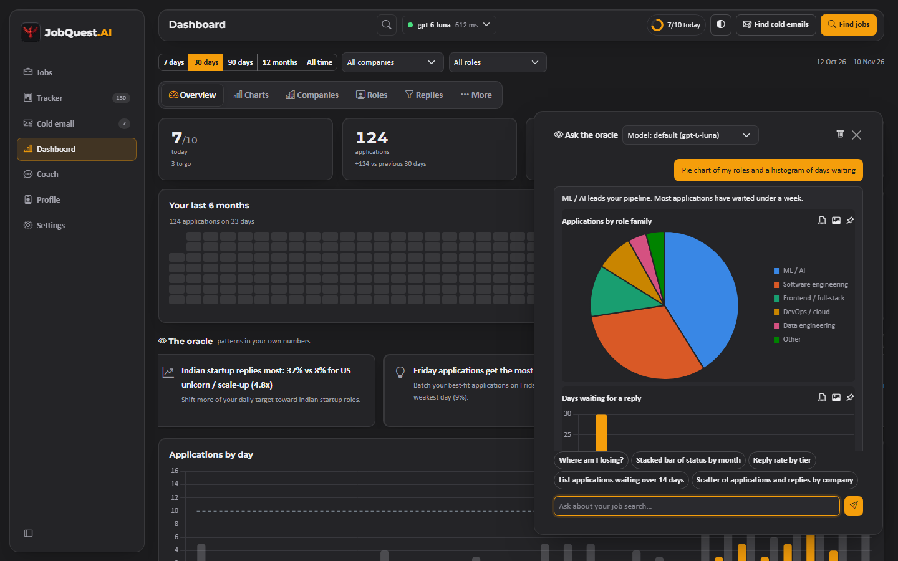 |

| Statistics: average, median, min, max | Every company you applied to, with careers links |
|---|---|
| 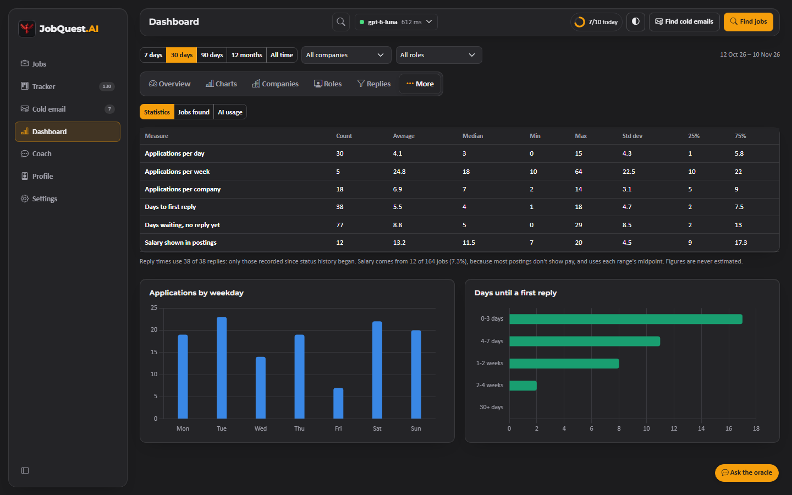 | 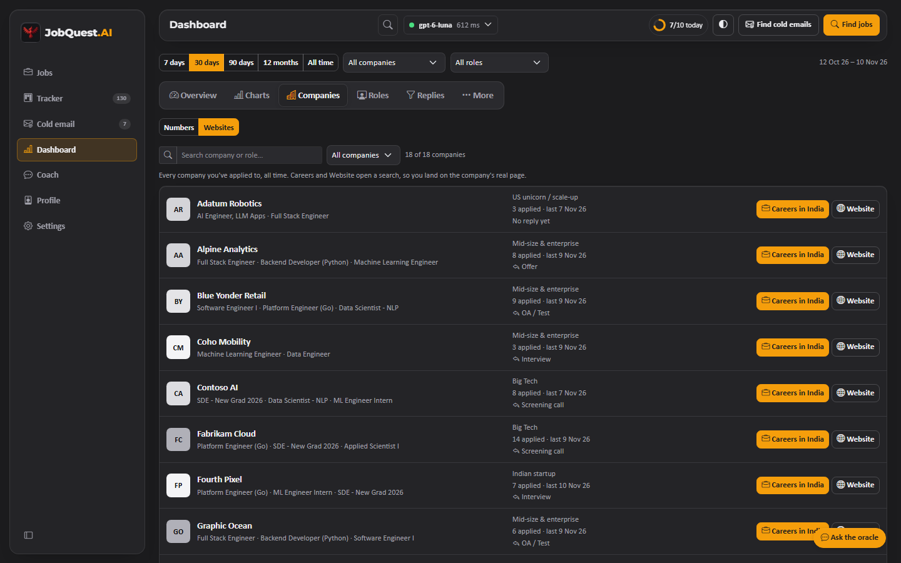 |

| Application tracker | AI usage and cost |
|---|---|
| 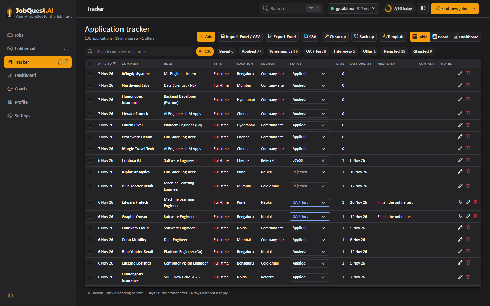 | 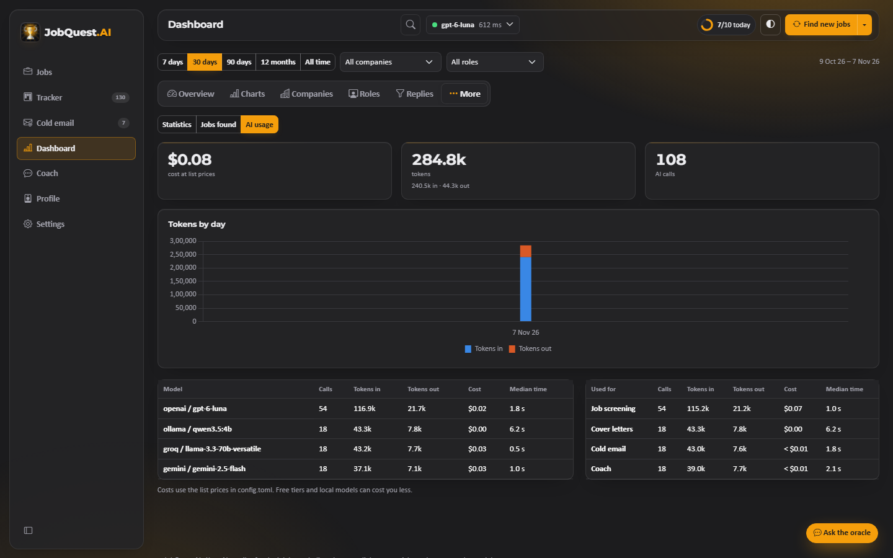 |

| Cold email desk | Coach with a model per chat |
|---|---|
| 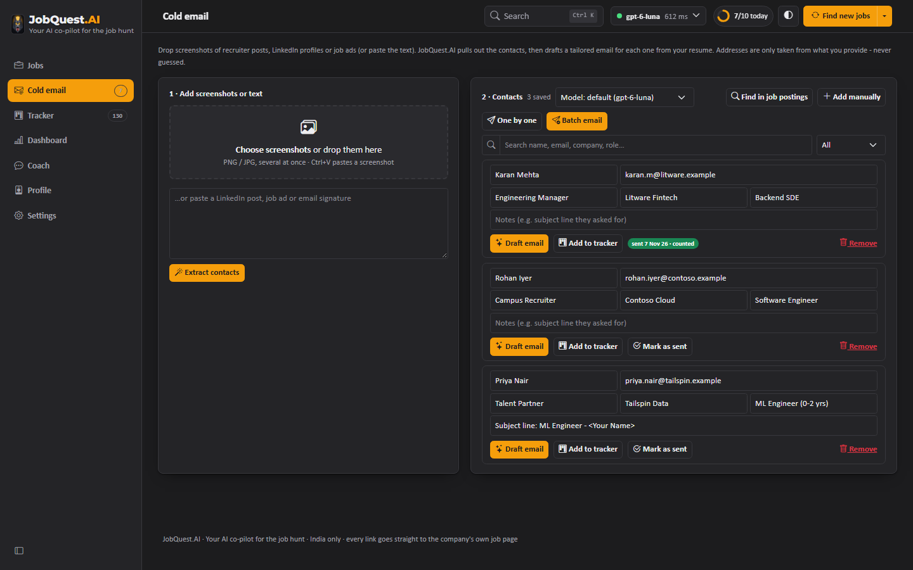 | 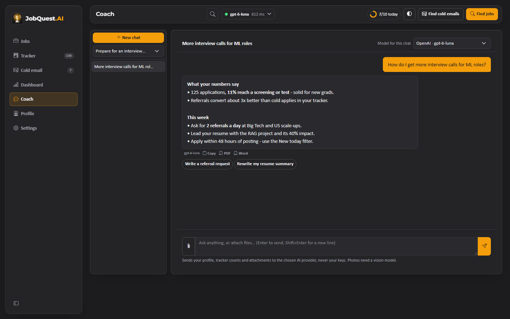 |

<details><summary>Settings and colour themes (15 themes plus a random-palette generator)</summary>

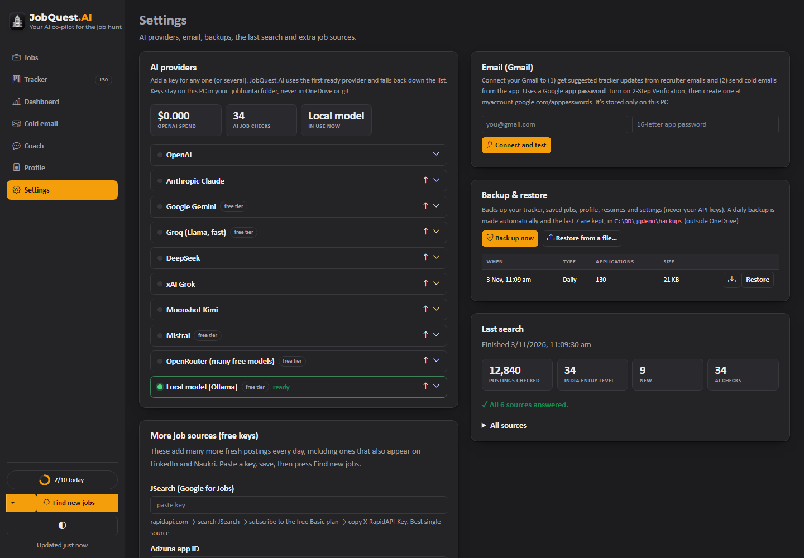
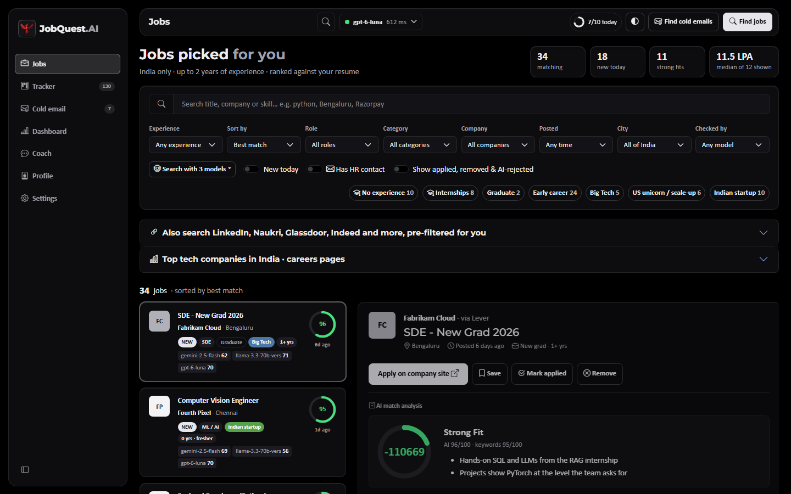
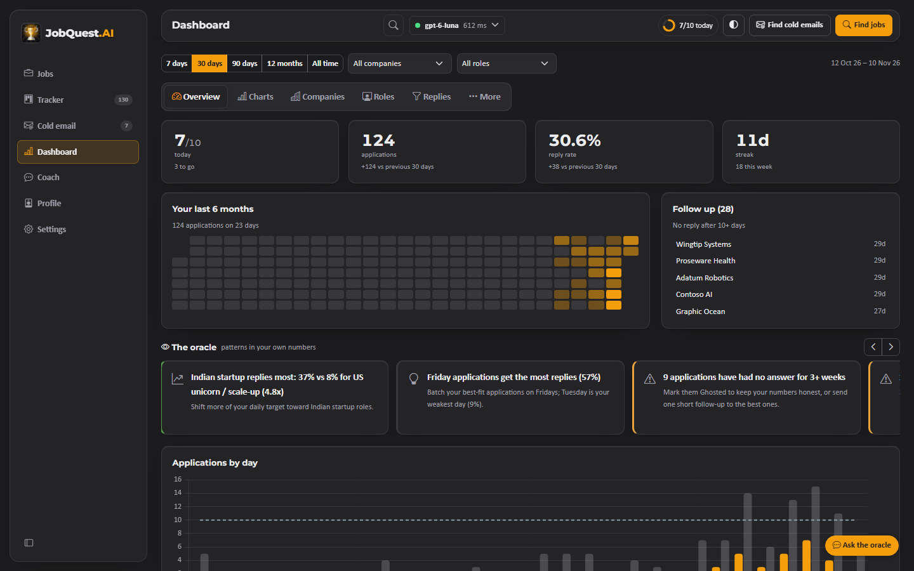
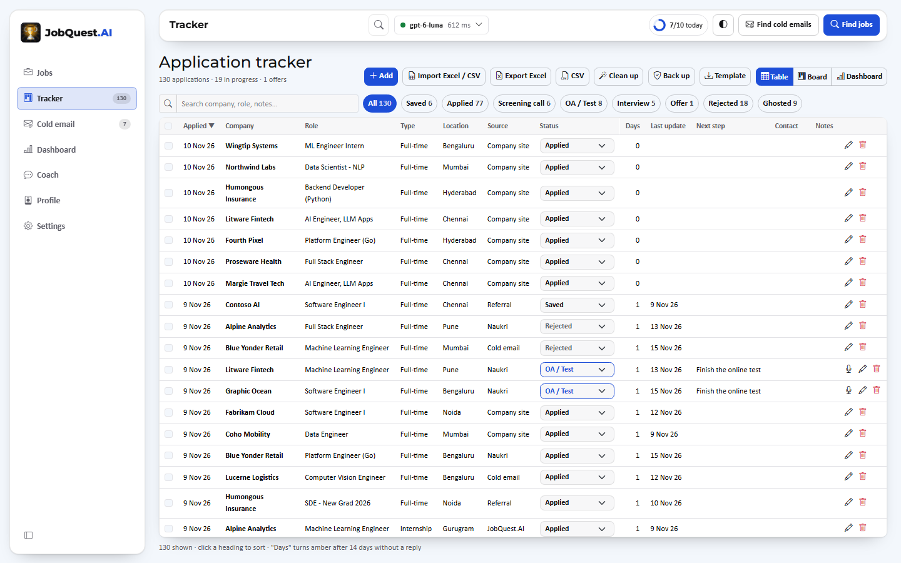
</details>

*All screenshots use the built-in demo data. Every person, company and email in them is fictional.*

## Features

**Job search**
- Pulls fresh postings from **145+ company boards** (Greenhouse, Lever, Ashby, Workday, amazon.jobs) plus the
  **big companies' own career sites**: Microsoft, Netflix, Oracle, JPMorgan Chase, Cisco, IBM, Goldman Sachs,
  Qualcomm, Atlassian, PhonePe and Capgemini. Google, Meta, Apple, Uber, Infosys, TCS and Flipkart need a login or a
  browser, so they get pre-filtered careers links instead. Optional JSearch (Google for Jobs), Adzuna and Jooble keys.
- **Finds your companies' boards:** each search looks up the public job boards of up to 40 more companies from your
  tracker, so the companies you care about get searched every time.
- **Smarter searching:** phrases planned from your roles and resume skills, the way Indian postings word entry-level
  roles (fresher, 0-2 years, SDE-1, Graduate Engineer Trainee, 2025/2026 batch), synonyms (GenAI, applied scientist)
  and spelling fixes, so "machin lerning" still finds machine learning jobs.
- **Jobs abroad, optional:** pick the Gulf, Singapore / Thailand / Malaysia, the US, UK, Canada, Australia, NZ, Ireland or
  Europe, and only roles whose posting offers **visa sponsorship or relocation** are kept. India always ranks first.
- Keeps only roles **in India** (or remote within India) up to the experience you set: no experience through
  5 years, 2 by default. Experience requirements are parsed from the text, and "preferred" sections are ignored.
- Scores each job against your resume twice: once by skill keywords, and once by an **LLM screen that returns
  structured output**. The screen gives the real years required, a fit score, reasons, missing skills, and
  contacts printed in the posting.
- Filters for **company tier**: Big Tech (FAANG / MANGO), US unicorns with India offices, Indian startups, and
  mid-size companies. Also filters by **years of experience**, **Internship, Graduate or Early career**, role family,
  **30 tech cities**, posting date and the model that checked the job, with one-click "Remove".
- **Claude screens first:** Claude Haiku reads every shortlisted job (up to 500 a search), then Claude Opus
  re-checks the best 100. A **Saver** mode runs the screen through Claude's batch API at half price.
- **Several models, one score:** OpenAI also checks the best jobs by default, and any model you add joins in. Their
  scores are combined into one ranking, and a big disagreement is flagged on the card.
- **Salaries** are read from postings when they're stated, or typed by you. They're never estimated, and sorting and
  medians say how many jobs they cover.
- Searches **only when you click**: *Find jobs* runs a search, with a progress bar in **percent**, and *Find cold
  emails* collects the hiring contacts printed in the postings you already have. Nothing searches on its own.
- A directory of **~300 top tech employers in India**, marking which boards are searched automatically. Glassdoor,
  Naukri, LinkedIn and the other sites that don't allow scraping get pre-filtered search links instead.

**Tracking and analytics**
- A tracker with a table or board view, inline status, bulk edit and delete with undo, and Excel / CSV import
  and export.
- Statuses run Saved → Applied → Screening call → OA / Test → Interview → Offer, plus Rejected, Ghosted and
  Withdrawn.
- An **oracle dashboard**:
  - Filters by date range (7 days to all time), by day, week or month, and by company and role.
  - Charts the jobs found by company, category and date, response rates by tier, role and source, days until a
    reply, and outcomes per company.
  - **Oracle cards** are rule-based findings computed in Python, each with a tip, for example "Startups reply
    4.8x more than US scale-ups".
  - **Tabs** for Overview, Statistics, Companies, Company list, Roles, Funnel & replies, Jobs found and AI usage.
  - **Statistics** gives count, average, median, min, max, spread and quartiles, all computed in Python.
  - **Top 10 pies** for companies and roles, and sortable tables that open the matching tracker rows.
  - The **Company list** shows each company you've applied to once, with careers-in-India and website links.
  - **Ask the oracle** answers from your tracker and can draw any **bar, pie or line chart, histogram or table**. The AI only
    picks what to show; Python counts every number, so it can't invent one.
  - **AI usage** breaks down tokens and cost by model, feature and day.
- **Excel export** with Applications, Companies, Roles, Role Families and Statistics sheets.
- **Clean up names:** autocorrects company names (typos, short forms, "Pvt Ltd" suffixes; "tcs" becomes Tata
  Consultancy Services) and roles ("mle eng" becomes Machine Learning Engineer). You tick the changes to apply,
  and they can be undone. Company and role inputs autocomplete, and a blank location defaults to India.
- **Role resumes:** reads up to 30 resumes from a folder, each tagged with its target role. Cold emails and
  cover letters pick the matching one automatically.
- A **daily target** (default 10) with a progress ring and Windows toast reminders.

**AI assistance (Claude first, any LLM welcome)**
- **Claude by default**, through Anthropic's own SDK: prompt caching, an effort level per task, structured output and
  exact costs. Then OpenAI, then Gemini, then the free providers: Groq, Mistral, OpenRouter's free models and more,
  plus **local models through Ollama** (Gemma, Qwen, Llama) for the Dashboard, oracle and Coach.
- **A model per task:** Coach, cover letters, cold email, interview prep, the Dashboard and search planning can each use
  any provider, free and local ones included. Left on default, Claude picks Haiku for bulk checks and Opus for writing.
- **Monthly spend limit** ($150 by default): when it's reached, paid models pause and the free ones carry on.
- A **model switcher** in the top bar shows each provider's live status and speed. Dashboard analysis, Cold email and each
  Coach chat can use their own model, or one setting can make a single tested model do everything.
- **Add your own:** any OpenAI-compatible service works as a custom model, so a new one needs no app update. It's tested before it's saved.
- Providers can be reordered, disabled without losing their key, and are tried in turn if one fails. With none configured,
  every AI feature says "Please add an LLM key".
- **Cover letters** from the job description, your resume and any extra files, such as a LinkedIn PDF. They
  download as a clean PDF set in Calibri, and a local model is preferred when one is available.
- **Coach**, with separate chats that know your profile and tracker. It accepts **files and photos** (vision), drafts CVs,
  emails and letters that export to **PDF or Word**, and suggests next steps.
- **Interview prep** per job: a prep sheet from the posting and your resume, then a mock interview with feedback.
- **Cold email desk:**
  - Drop in screenshots of recruiter posts, or paste text, and it extracts each contact's name, email, title,
    company and the role they're hiring for.
  - It can also collect every hiring email printed in your job postings.
  - It drafts a tailored email for each contact, and a sent email counts as an application.
  - **Email them one by one** walks through each unsent contact. It drafts each email and attaches the
    role-matched resume, then waits for **Send**, Skip or Stop.
  - **Batch email** fills a template or writes each draft with AI. You review every one, then one click sends them
    about 45 seconds apart, 50 a day at most, with a Stop button.

**Dashboard**
- **Ask the oracle** for any chart, table or list: bar, stacked, line, area, pie, doughnut, polar, radar, scatter, histogram,
  a single number or a list of applications. It only names what to show; Python counts every number.
- **My charts**: build a chart without AI, and pin any chart to the dashboard. Pins recount from your latest data.
- A six-month activity calendar, follow-ups due, and a comparison with the previous period.
- Download any chart as an image or CSV.

**Email (Gmail, app password)**
- Used only for cold email: sends after you review and press Send. Your inbox is never read.
- A guided setup connects Gmail with an app password.

**Sync and security**
- API keys, the Gmail password and the Atlas connection are encrypted with Windows DPAPI, tied to your account.
- Each launch gets its own session key, and the app loads nothing from outside itself, so it also works offline.
- **MongoDB Atlas sync:** paste a connection string in Settings to use your data on several PCs. It syncs on launch and every
  6 hours, merging row by row so the newest edit wins and deletions carry over. Snapshots are encrypted with your
  passphrase before upload, so Atlas only stores unreadable data. API keys never leave the PC.

## Architecture

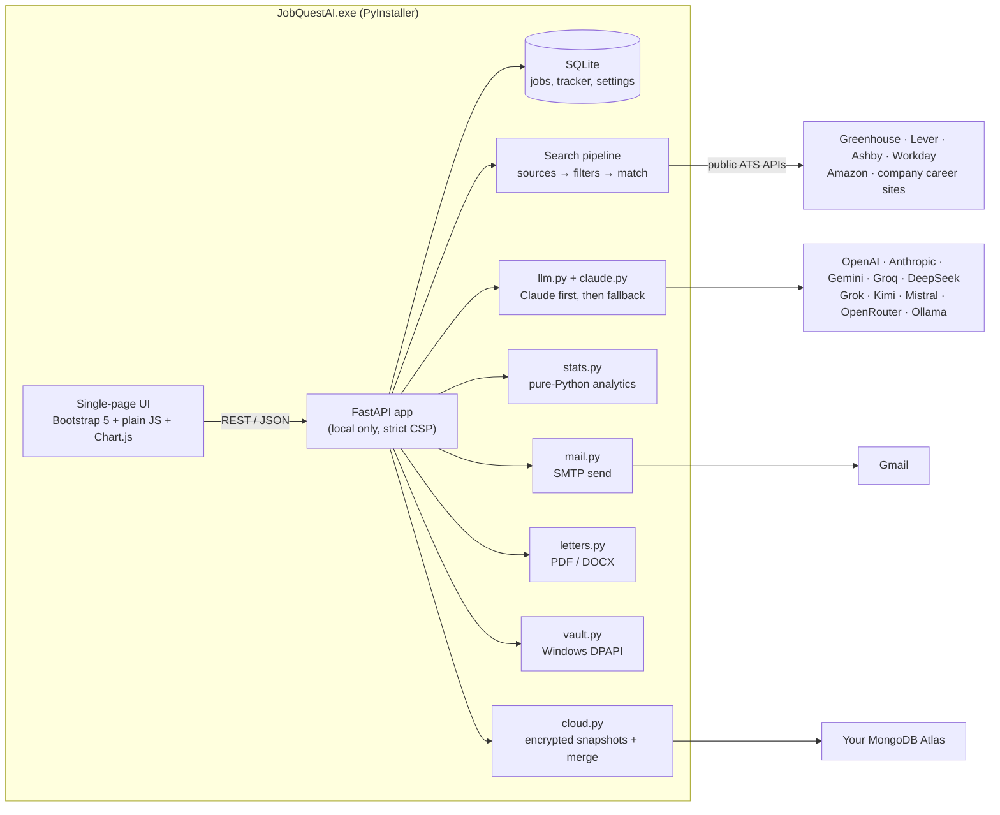

| Layer | Tech |
|---|---|
| Backend | Python 3.13, FastAPI, Uvicorn, Pydantic, SQLite (WAL), PyMongo (GridFS) |
| AI | OpenAI SDK against any OpenAI-compatible endpoint, structured outputs with a JSON-mode fallback, vision input |
| Front end | Bootstrap 5.3, Bootstrap Icons, Chart.js 4 (all vendored), plain JavaScript with no build step |
| Documents | pypdf, python-docx, fpdf2, openpyxl |
| Desktop | PyInstaller single-file exe, Edge app-mode window, WinRT toast notifications |
| Quality | 125+ `unittest` tests, pyflakes, a strict Content-Security-Policy, session keys, local-only host and origin checks |

## Run it

**Install on Windows (recommended):** download **`JobQuestAI-Setup-4.0.0.exe`** from the
[latest release](../../releases/latest) and run it.
- It installs for your user only, with no admin prompt, into `%LOCALAPPDATA%\Programs\JobQuest.AI`.
- It adds Start menu and optional Desktop shortcuts. Searches run only when you click, so it schedules nothing.
- Uninstall it from *Settings → Apps* like any other app. Your data in `%USERPROFILE%\.jobhuntai` is kept.

**Portable:** download `JobQuestAI.exe` from the same release and double-click it; there's nothing to install.

To build the installer yourself, run `build_exe.cmd`, then `build_installer.cmd`, which needs
[Inno Setup 6](https://jrsoftware.org/isinfo.php): `winget install JRSoftware.InnoSetup`.

**From source:**
```bash
git clone https://github.com/striderzz/JobQuest.AI.git
cd JobQuest.AI
python -m venv .venv && .venv\Scripts\activate
pip install -r requirements.txt
python -m jobhunt serve          # opens the app in your browser
```

Then:
1. **Profile:** upload your resume (PDF or DOCX).
2. **Settings:** add any AI key. Gemini, Groq and OpenRouter have free tiers, or run Ollama locally.
3. Press **Find new jobs**.

**Try it with demo data** (fictional, never touches your real data folder):
```bash
set JOBHUNT_HOME=%TEMP%\jobquest-demo
python -m jobhunt demo
python -m jobhunt serve --port 8010    # prints the link to open, with this launch's session key
```

Other commands: `build_exe.cmd` builds the exe. `refresh.cmd` runs one search from the command line.
`python -m unittest discover -s tests -t .` runs the tests.

## How the desktop app is built

JobQuest.AI is a FastAPI web app packaged as a native-feeling Windows program.

**1. One-file exe (PyInstaller).** `build_exe.cmd` runs these steps:
- `packaging/make_icon.py` turns the quest trophy logo (`logo.png`, drawn by `draw_trophy.py`) into `jobquestai.ico` and the in-app icon.
- `python -m PyInstaller --onefile --noconsole --name JobQuestAI` bundles the Python runtime, FastAPI, Uvicorn and every
  library into a single `JobQuestAI.exe` (about 38 MB).
- `--add-data` packs the web UI (`jobhunt/static`) and `config.toml` inside it, and `--collect-submodules uvicorn` keeps the
  server's dynamic imports.
- `packaging/launcher.py` is the entry point.

**2. What happens on launch** (`jobhunt/desktop.py`):
- The exe starts the FastAPI server with Uvicorn in a background thread on `127.0.0.1:8000`, listening locally only.
- It opens **Microsoft Edge in app mode** (`--app=...`) with its own profile, giving a clean window with no tabs or address bar.
- It watches that window's profile, and stops the server shortly after the last window closes.
- A background thread runs cloud sync and the daily-target reminders (Windows toasts). It never starts a search.
- All data stays in `%USERPROFILE%\.jobhuntai`, outside the exe: the SQLite database, resumes, API keys and backups. So
  rebuilding or reinstalling never loses anything.

**3. Installer (Inno Setup).** `build_installer.cmd` compiles `packaging/installer.iss` into
`dist\JobQuestAI-Setup-<version>.exe`, which:
- installs per user with no admin prompt into `%LOCALAPPDATA%\Programs\JobQuest.AI`;
- adds Start menu and optional Desktop shortcuts;
- removes the timed searches that versions before 4.0 could schedule;
- adds a normal uninstaller (*Settings → Apps*) that leaves your data folder alone.

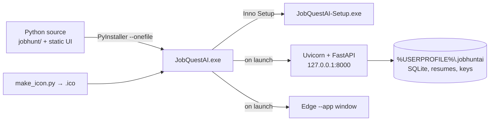

Rebuild after a code change:
```bash
build_exe.cmd
build_installer.cmd
```

## Privacy and fair use

- Everything runs on your PC. Keys, the database, resumes and backups live in `~/.jobhuntai`, outside the repo.
  Keys are encrypted, and backups and sync never include them.
- Cloud sync is optional and uses your own Atlas cluster, with data encrypted before it leaves your PC.
- Jobs come only from **public job-board APIs** and the public JSON that companies' own career pages use, read with
  [Scrapling](https://github.com/D4Vinci/Scrapling)'s plain HTTP fetcher. Requests name the app honestly, go at a
  polite pace per site, and **respect robots.txt** (so SmartRecruiters, which allows only LinkedIn's crawler, isn't
  read). No browser automation, no bot-check workarounds. The app does not scrape LinkedIn, Naukri or Glassdoor;
  it links to pre-filtered searches on those sites instead.
- Contact emails are only ones **printed in postings** or in material you provide. The app never guesses or
  constructs an address.
- AI calls send only what each feature needs, to the provider you chose. Dashboard insights get aggregate numbers only.
  The oracle and Coach also see company and role names with counts, but never your notes, contacts or emails.
- No email is ever sent without your explicit click.

## Roadmap

- Embeddings-based semantic matching alongside the keyword score
- macOS / Linux packaging

## License

MIT. Use it, fork it, and good luck with the hunt.
