<p align="center">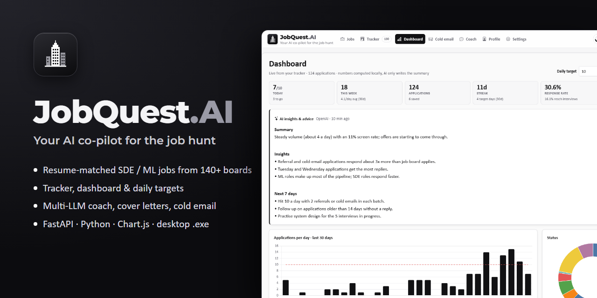</p>

# JobQuest.AI

**Your AI co-pilot for the job hunt.** A desktop app that finds entry-level SDE / ML / AI jobs in India, ranks them
against your resume, tracks every application, and helps with the outreach around them: cover letters, cold
emails, a resume coach, and Gmail-based status updates. It runs locally, works with any of 10 LLM providers
(or a local model), and ships as a single Windows `.exe`.

> Built as a capstone project: a full-stack Python application covering data ingestion from 140+ job boards, an
> LLM layer with structured outputs and provider fallback, analytics, email integration, and desktop packaging.

## Screenshots

| Jobs, ranked against your resume | Application tracker |
|---|---|
| 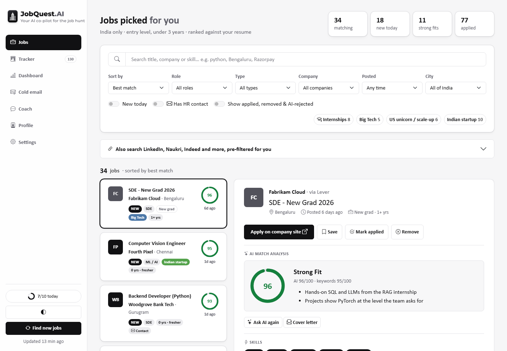 | 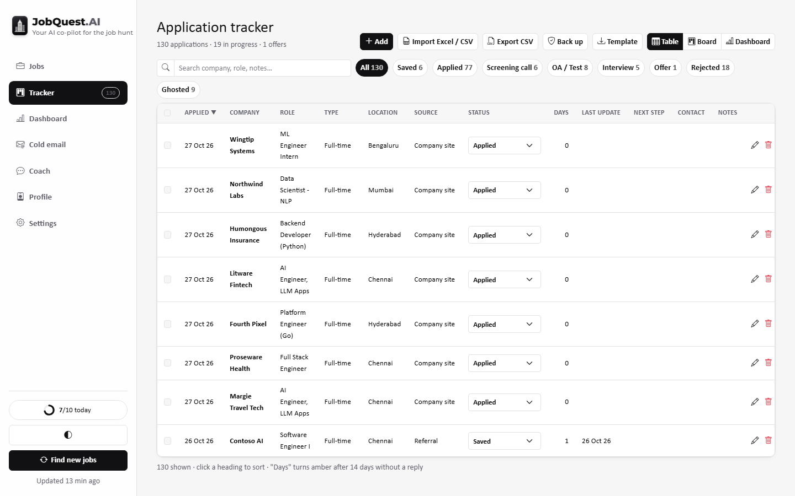 |

| Dashboard + AI insights | Cold email desk |
|---|---|
| 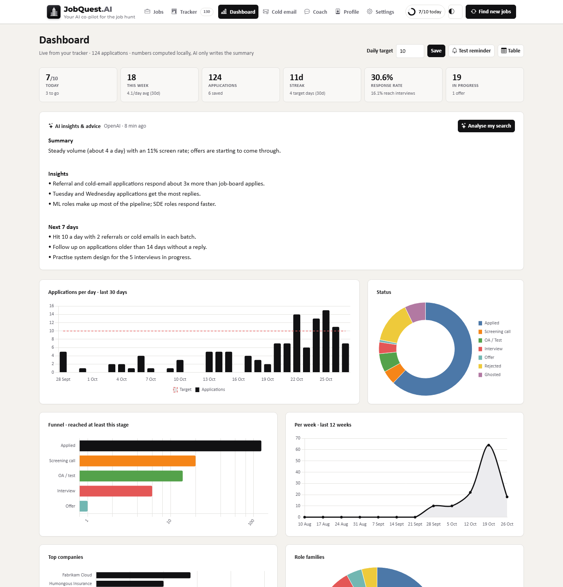 | 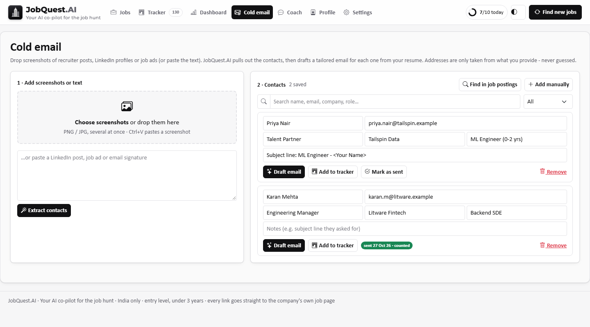 |

| Coach (chat with files and photos) | Settings: 10 AI providers, Gmail, backups |
|---|---|
| 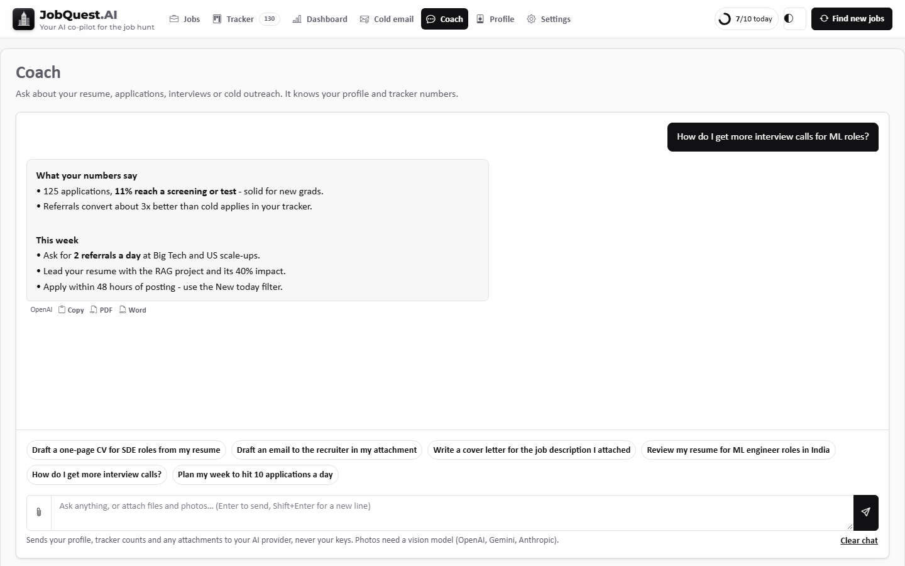 | 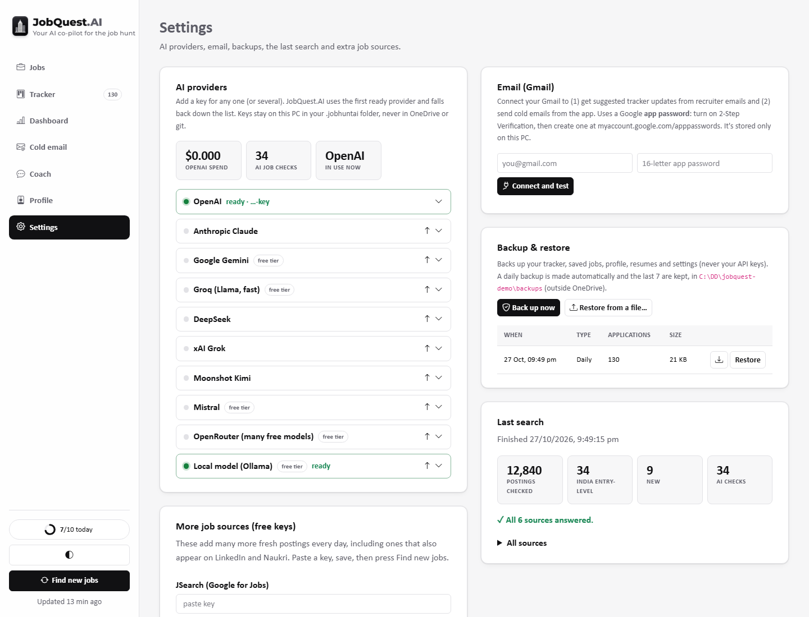 |

<details><summary>Dark and colour themes (15 themes plus a random-palette generator)</summary>

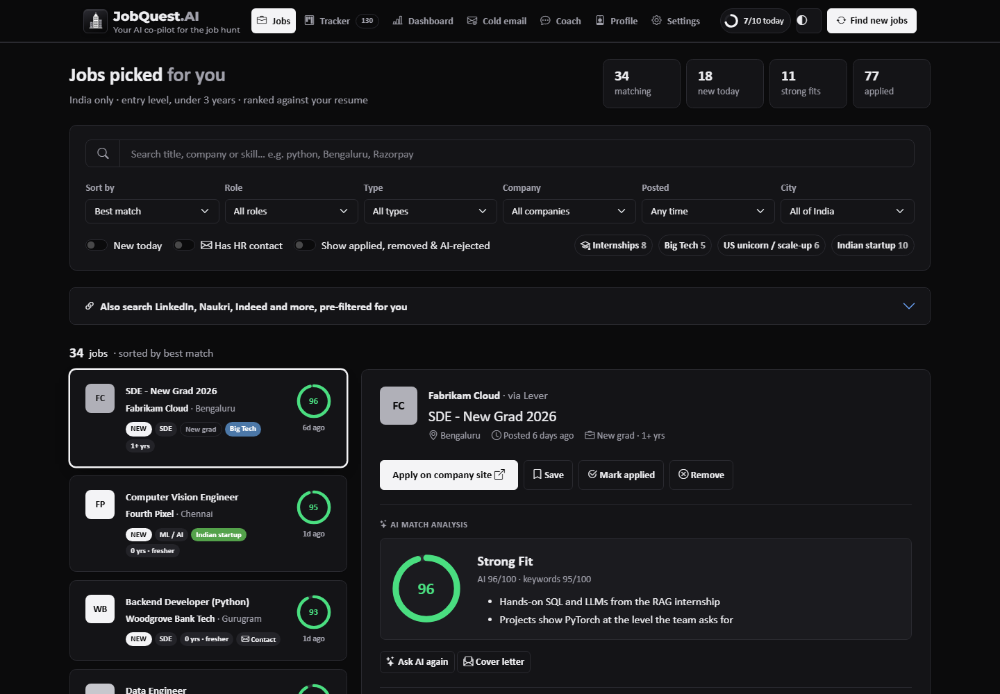
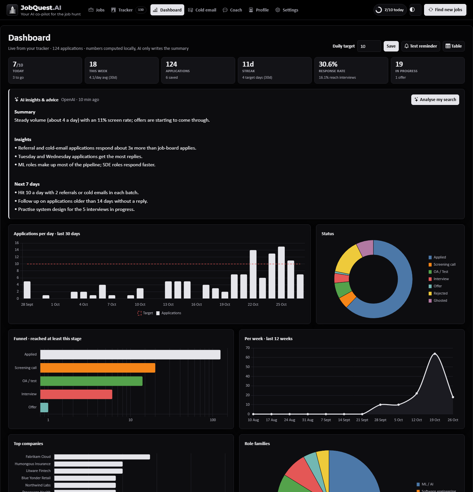
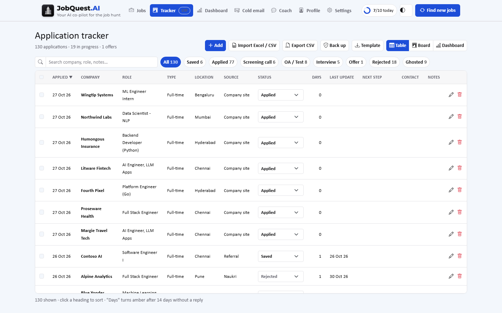
</details>

*All screenshots use the built-in demo data. Every person, company and email in them is fictional.*

## Features

**Job search**
- Pulls fresh postings from **140+ company boards**: Greenhouse, Lever, Ashby, SmartRecruiters, Workday and
  amazon.jobs APIs, plus optional JSearch (Google for Jobs), Adzuna and Jooble keys.
- Keeps only roles **in India** (or remote within India) that are **entry level**: intern, new grad, or under
  3 years. Experience requirements are parsed from the text, and "preferred" sections are ignored.
- Scores each job against your resume twice: once by skill keywords, and once by an **LLM screen that returns
  structured output**. The screen gives the real years required, a fit score, reasons, missing skills, and
  contacts printed in the posting.
- Filters for **company tier**: Big Tech (FAANG / MANGO), US unicorns with India offices, Indian startups, and
  mid-size companies. Also filters by role, city, posting date and internships, with one-click "Remove".
- Refreshes every 12 hours, in the app and through a Windows scheduled task.

**Tracking and analytics**
- A tracker with a table or board view, inline status, bulk edit and delete with undo, and Excel / CSV import
  and export.
- Statuses run Saved → Applied → Screening call → OA / Test → Interview → Offer, plus Rejected, Ghosted and
  Withdrawn.
- A **dashboard** of applications per day and week, a funnel, status, top companies, role families, company
  tiers, weekdays, sources and locations. All numbers are computed in Python. The LLM only writes the
  **insights and advice** summary, and it sees only aggregate numbers, never names.
- A **daily target** (default 10) with a progress ring and Windows toast reminders.

**AI assistance (bring any LLM)**
- **10 providers** through one OpenAI-compatible layer: OpenAI, Anthropic, Google Gemini, Groq, DeepSeek,
  xAI Grok, Moonshot Kimi, Mistral and OpenRouter, plus a **local model through Ollama**.
- Providers can be reordered, are tried in turn if one fails, and each has a test button. With none configured,
  every AI feature says "Please add an LLM key".
- **Cover letters** from the job description, your resume and any extra files, such as a LinkedIn PDF. They
  download as a clean PDF set in Calibri, and a local model is preferred when one is available.
- **Coach**, a chat that knows your profile and tracker numbers. It accepts **files and photos** (vision) and
  drafts CVs, emails and letters, which export to **PDF or Word**.
- **Cold email desk:**
  - Drop in screenshots of recruiter posts, or paste text, and it extracts each contact's name, email, title,
    company and the role they're hiring for.
  - It can also collect every hiring email printed in your job postings.
  - It drafts a tailored email for each contact, and a sent email counts as an application.

**Email (Gmail, app password)**
- Reads recent job emails without changing them. It classifies each one (rejection, OA, interview, screening,
  offer), matches it to tracker rows, and **proposes** updates for you to approve. It never moves an
  application backwards.
- Sends cold emails one at a time, only after you review the email and press Send.

## Architecture

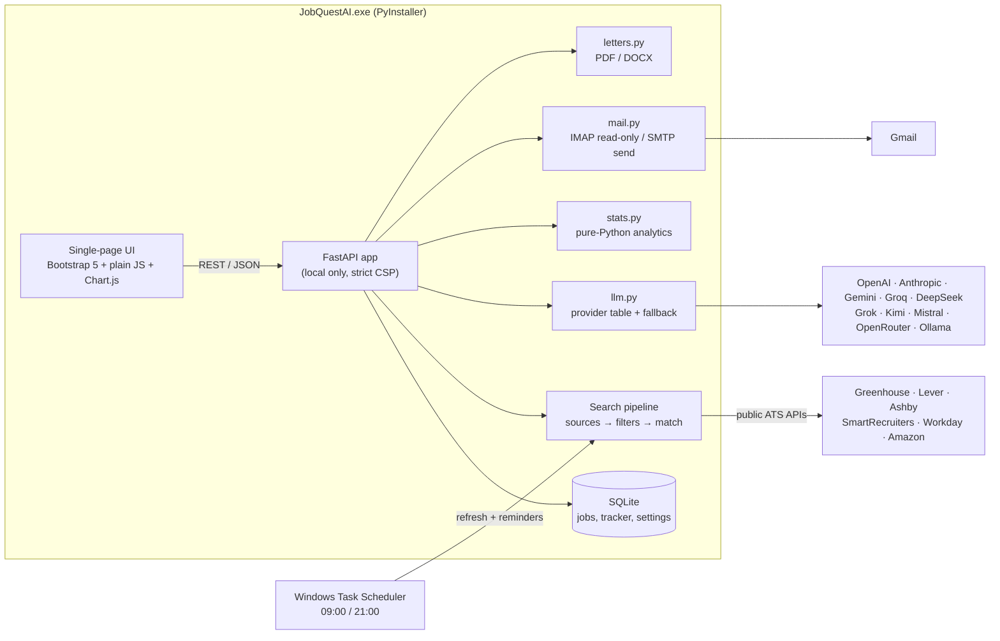

| Layer | Tech |
|---|---|
| Backend | Python 3.13, FastAPI, Uvicorn, Pydantic, SQLite (WAL) |
| AI | OpenAI SDK against any OpenAI-compatible endpoint, structured outputs with a JSON-mode fallback, vision input |
| Front end | Bootstrap 5.3, Bootstrap Icons, Chart.js 4 (vendored), plain JavaScript with no build step |
| Documents | pypdf, python-docx, fpdf2, openpyxl |
| Desktop | PyInstaller single-file exe, Edge app-mode window, WinRT toast notifications |
| Quality | 50+ `unittest` tests, pyflakes, a strict Content-Security-Policy, local-only host and origin checks |

## Run it

**Install on Windows (recommended):** download **`JobQuestAI-Setup-1.0.0.exe`** from the
[latest release](../../releases/latest) and run it.
- It installs for your user only, with no admin prompt, into `%LOCALAPPDATA%\Programs\JobQuest.AI`.
- It adds Start menu and optional Desktop shortcuts, and can optionally schedule a job search every 12 hours.
- Uninstall it from *Settings → Apps* like any other app. Your data in `%USERPROFILE%\.jobhuntai` is kept.

**Portable:** download `JobQuestAI.exe` from the same release and double-click it; there's nothing to install.

To build the installer yourself, run `build_exe.cmd`, then `build_installer.cmd`, which needs
[Inno Setup 6](https://jrsoftware.org/isinfo.php): `winget install JRSoftware.InnoSetup`.

**From source:**
```bash
git clone https://github.com/striderzz/JobQuest.AI.git
cd JobQuest.AI
python -m venv .venv && .venv\Scripts\activate
pip install -r requirements.txt
python -m jobhunt serve          # opens http://127.0.0.1:8000
```

Then:
1. **Profile:** upload your resume (PDF or DOCX).
2. **Settings:** add any AI key. Gemini, Groq and OpenRouter have free tiers, or run Ollama locally.
3. Press **Find new jobs**.

**Try it with demo data** (fictional, never touches your real data folder):
```bash
set JOBHUNT_HOME=%TEMP%\jobquest-demo
python -m jobhunt demo
python -m jobhunt serve --port 8010
```

Other commands: `build_exe.cmd` builds the exe. `schedule_daily.ps1` registers the 12-hour refresh.
`python -m unittest discover -s tests -t .` runs the tests.

## How the desktop app is built

JobQuest.AI is a FastAPI web app packaged as a native-feeling Windows program.

**1. One-file exe (PyInstaller).** `build_exe.cmd` runs these steps:
- `packaging/make_icon.py` draws the skyscraper icon with Pillow and writes `jobquestai.ico`.
- `python -m PyInstaller --onefile --noconsole --name JobQuestAI` bundles the Python runtime, FastAPI, Uvicorn and every
  library into a single `JobQuestAI.exe` (about 34 MB).
- `--add-data` packs the web UI (`jobhunt/static`) and `config.toml` inside it, and `--collect-submodules uvicorn` keeps the
  server's dynamic imports.
- `packaging/launcher.py` is the entry point.

**2. What happens on launch** (`jobhunt/desktop.py`):
- The exe starts the FastAPI server with Uvicorn in a background thread on `127.0.0.1:8000`, listening locally only.
- It opens **Microsoft Edge in app mode** (`--app=...`) with its own profile, giving a clean window with no tabs or address bar.
- It waits on that window, and closing it stops the server. If a window from an earlier run is still open, it keeps
  serving until that one closes too.
- A background thread runs the 12-hour job refresh, the Gmail check and the daily-target reminders (Windows toasts).
- All data stays in `%USERPROFILE%\.jobhuntai`, outside the exe: the SQLite database, resumes, API keys and backups. So
  rebuilding or reinstalling never loses anything.

**3. Installer (Inno Setup).** `build_installer.cmd` compiles `packaging/installer.iss` into
`dist\JobQuestAI-Setup-<version>.exe`, which:
- installs per user with no admin prompt into `%LOCALAPPDATA%\Programs\JobQuest.AI`;
- adds Start menu and optional Desktop shortcuts;
- can optionally register the 09:00 / 21:00 job search as a scheduled task;
- adds a normal uninstaller (*Settings → Apps*) that leaves your data folder alone.

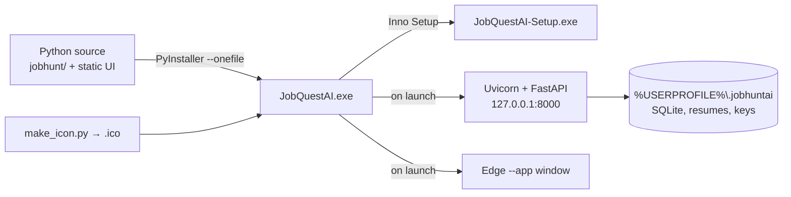

Rebuild after a code change:
```bash
build_exe.cmd
build_installer.cmd
```

## Privacy and fair use

- Everything runs on your PC. Keys, the database, resumes and backups live in `~/.jobhuntai`, outside the repo,
  and backups never include keys.
- Jobs come only from **public job-board APIs**. The app does not scrape LinkedIn, Naukri or Glassdoor, which
  ban it; instead it links to pre-filtered searches on those sites.
- Contact emails are only ones **printed in postings** or in material you provide. The app never guesses or
  constructs an address.
- AI calls send only what each feature needs. The dashboard insights get aggregate numbers only.
- No email is ever sent without your explicit click.

## Roadmap

- Embeddings-based semantic matching alongside the keyword score
- Interview-prep packs per job (likely questions from the JD)
- macOS / Linux packaging

## License

MIT. Use it, fork it, and good luck with the hunt.
